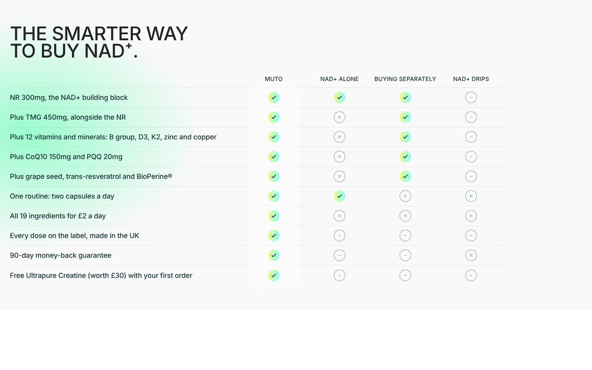
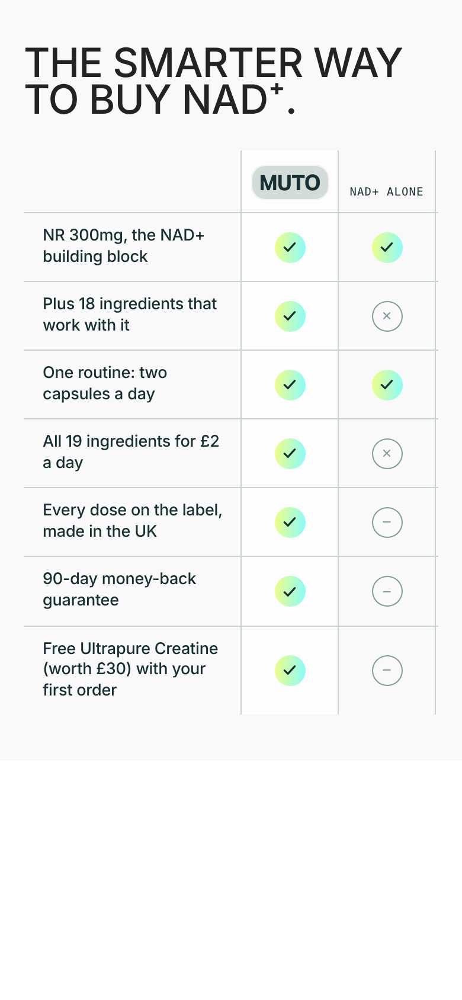

Thanks for shipping the 12 October handoff. Today's changes are the **Garmin watch giveaway** (replacing Oura) and a **new comparison table** on the NAD+ product pages. Some of it is already done in Shopify admin; the rest is **7 theme files** in `shopify/live-ready`.

# Before you start

- **Copy from:** `shopify/live-ready` in GitHub (repo drrichiebarclay-rgb/claude, branch `claude/faq-page-shopify-redesign-hbqcg8`): <https://github.com/drrichiebarclay-rgb/claude/tree/claude/faq-page-shopify-redesign-hbqcg8/shopify/live-ready>.
- **Copy to:** the live theme, Clone Of Live | Buy Box Redesign [31-08] (ID 200736047451). **Sections first, then templates.** The NAD+ templates use options that only exist in the new compare section.
- **Your live edits are kept.** I saw you've been editing live directly, for example the creatine-kit page's "Welcome kit worth £62" banner, the row notes, the new 90-day timeline copy ("No spike. No crash." …) and the 3-month plan card. So every template in the folder was rebuilt from a snapshot of **live taken on 13 Oct**, with only today's changes applied. Each file differs from live only in the areas listed below. If you edit live again before copying, tell me and I'll rebuild from the newer live.
- **Already shipped, so removed from the folder:** `sections/muto-crea-buy.liquid` (your live copy also drops the "Pre-Order Now" text, so it's kept as is), `product.muto-socks.json` and `product.muto-bottle.json`.
- **Preview everything working together:** the 3M refill plan theme (ID 202682564955), for example <https://muto.co/products/muto-nad-cellular-complex?view=muto-nad-creatine-kit&preview_theme_id=202682564955>.

# Already done in Shopify admin (no action)

| What | Change |
|---|---|
| Giveaway terms page (`/pages/better-baseline-giveaway`) | Retitled "Garmin Watch Giveaway Terms & Conditions". Prize section: each quarter one winner, chosen at random, picks a Garmin watch from the UK range up to £200 including VAT; MUTO orders and delivers it; no cash for any difference. Entry link and disclaimer now name Garmin. "Last updated 13 October 2026" added. All other clauses unchanged. |
| Free-entry product | Now "Chance to Win a Garmin Watch" at `/products/chance-to-win-garmin-watch`. The old `/products/chance-to-win-oura-ring-5` redirects to it. SEO title and description added. Garmin image added, Oura image detached (the file stays in Files). |
| Shopify Files | New `gift-garmin.jpg` (908×1138, same style as the Oura tile) for the welcome-kit gift. |
| Footer Company menu | New link "Garmin Watch Giveaway" to the terms page. "Mange Your Subscription" corrected to "Manage". |

# The 7 files to copy

| File | What changed (and nothing else) |
|---|---|
| `sections/muto-crea-compare.liquid` | Live file plus: a **Density** setting (Spacious = today's look, Compact = new), **Group label** blocks, `max_blocks` 16, and the MUTO wordmark on mobile drawn as inline SVG (it was a CSS mask). Defaults are unchanged, so other pages using this section look the same. |
| `sections/faq-schema.liquid` | One answer: first-order gifts now mention "entry into our quarterly draw to win a Garmin watch". |
| `templates/page.faq-new.json` | The same FAQ answer, visible on the page. |
| `templates/product.give-away.json` | Entry form heading "ENTER YOUR EMAIL FOR A CHANCE TO WIN A GARMIN WATCH." and a line about the £200 prize with the terms link. |
| `templates/product.muto-nad.json` | Giveaway gift tile (Garmin image, "Garmin Watch / giveaway entry") and reassurance line "Entry to our Garmin watch prize draw (T&Cs)". New comparison table (below). |
| `templates/product.muto-nad-simple.json` | Same as above in the simple page's wording ("A chance to win a Garmin watch (rules)"), plus the simple comparison table. |
| `templates/product.muto-nad-creatine-kit.json` | Giveaway tile and its list row "Chance to win a Garmin Watch". New comparison table with the free-creatine row. Your live edits on this page are kept. |

# The new comparison table

**Goal:** make it obvious MUTO is the smarter way to buy NAD+, and that it saves money. It's positioned against NAD+-only products, then shows what else is inside, then trust signals and the gift.

**Layout:** Compact density: about 48px rows, 17px claims, 28px marks, hairlines between rows, equal-width columns. It's about 750px tall on desktop and 850px on a phone, down from more than 1,600px.

**Heading:** "The smarter way / to buy NAD⁺." (simple page: "The easy way / to get NAD⁺."). The heading uses the superscript-plus character **⁺ (U+207A), not "+"**. `custom.js` wraps any ASCII "NAD+" in ``, and inside this flex-column heading that pushed the "+" and the "." onto their own lines. Please keep ⁺ if you edit the heading.

**Columns:** MUTO | NAD+ alone | Buying separately | NAD+ drips (simple page: "Lots of pills" instead of "Buying separately").

| Claim | MUTO | NAD+ alone | Separately | Drips |
|---|---|---|---|---|
| NR 300mg, the NAD+ building block | ✓ | ✓ | ✓ | – |
| Plus TMG 450mg, alongside the NR | ✓ | ✗ | ✓ | – |
| Plus 12 vitamins and minerals: B group, D3, K2, zinc and copper | ✓ | ✗ | ✓ | – |
| Plus CoQ10 150mg and PQQ 20mg | ✓ | ✗ | ✓ | – |
| Plus grape seed, trans-resveratrol and BioPerine® | ✓ | ✗ | ✓ | – |
| One routine: two capsules a day | ✓ | ✓ | ✗ | ✗ |
| All 19 ingredients for £2 a day | ✓ | ✗ | ✗ | ✗ |
| Every dose on the label, made in the UK | ✓ | – | – | – |
| 90-day money-back guarantee | ✓ | – | – | ✗ |
| Last row: creatine-kit page "Free Ultrapure Creatine (worth £30) with your first order"; other pages "Free welcome kit with your first order" | ✓ | – | – | – |

"–" means not stated: we don't know what competitors offer, so we don't claim a cross. **Evidence for the price row:** MUTO is £60 a month, so £2 a day. Tru Niagen (NR alone) is £55.99 for 30 days at Superdrug (about £1.87 a day), which is why the row says "All 19 ingredients for £2 a day" rather than just "£2 a day".

{width=6.3in}

{width=2.6in}

# Notes

- [ ] **Draft theme vs live:** the 3M refill plan theme's creatine-kit page doesn't have your live edits (the £62 banner, the row notes, the 90-day timeline copy). Tell me if you want them pulled back into the draft theme.
- [ ] **Klaviyo entry form (W2NJnh):** the "aged 18 or over" checkbox is set up as a promotional SMS opt-in and isn't required. So entrants don't actually confirm their age, and anyone who ticks it joins SMS marketing. Please change it to a required, plain checkbox.
- [ ] **Giveaway change mid-quarter:** people entered since 1 October entered for an Oura Ring 5, and the Garmin prize is worth less. That was Richie's decision; flagging it for a legal check.
- [ ] **Template name:** the terms page still uses the template `page.oura-giveaway`. Customers don't see this; rename it only if you want things tidy.

# Check after publishing

1. **NAD+ product page:** the comparison table shows "The smarter way to buy NAD⁺." on two clean lines, 10 rows, compact. The giveaway tile shows the Garmin watch, and the reassurance line says Garmin.
2. **On a phone:** the MUTO logo shows in the grey chip at the top of the MUTO column, and the claims column stays pinned while the other columns scroll.
3. **Creatine-kit page** (`?view=muto-nad-creatine-kit`): your banner, row notes and timeline copy are still there. The last comparison row is the free creatine.
4. **Simple page** (`?view=muto-nad-simple`): plain-English table, "The easy way to get NAD⁺.".
5. **FAQ (/pages/faqs):** the first-order gifts answer mentions the Garmin watch.
6. **Entry form (/products/chance-to-win-garmin-watch):** heading says Garmin watch. The old Oura URL redirects here.
7. **Other pages using the compare section** (for example the creatine product page): unchanged.
