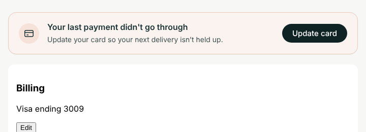
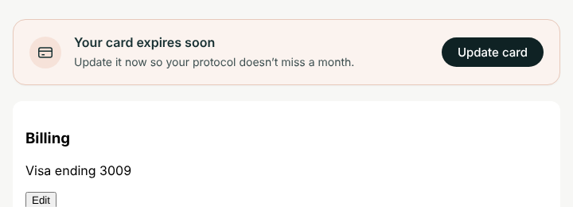
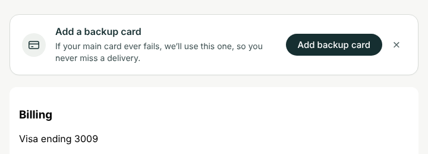
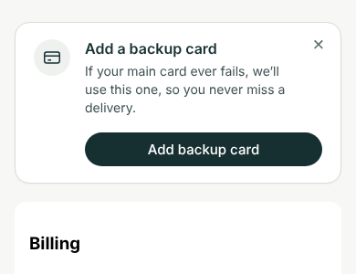

A notice at the top of the Skio Customer Portal (v3). It shows at most one message, in this order:

| Priority | When | Message | Button |
|---|---|---|---|
| 1 | Last payment failed | Your last payment didn't go through. Update your card so your next delivery isn't held up. | Update card |
| 2 | Card expires within 30 days | Your card expires soon. Update it now so your protocol doesn't miss a month. | Update card |
| 3 | No backup card | Add a backup card. If your main card ever fails, we'll use this one, so you never miss a delivery. | Add backup card (dismissible for 30 days) |

Nothing shows when none apply, or when the billing status can't be read.

{width=6in}

{width=6in}

{width=6in}

{width=3in}

## What's done

- Markup, brand styling (desktop and mobile), priority logic, and the 30-day expiry window.
- **Buttons** open the portal's own controls: the Billing section's **Edit** button for "Update card", and the backup payment button for "Add backup card". If neither can be found, they fall back to the Quick Action links in `CONFIG`.
- **Dismissing the backup-card message** hides it for 30 days in that browser. The payment messages can't be dismissed.
- **Preview mode:** add `?muto-billing=failed`, `?muto-billing=expiring` or `?muto-billing=nobackup` to the portal URL to see each state without real data.
- **Tested** in a mock portal page: each state shows the right message, the buttons click the portal's controls, nothing shows when all is well or the data is missing, and the dismiss is remembered.

## What the developer needs to do

### 1. Wire up `loadBillingStatus()`

It's the one function marked `TODO`. It should resolve to:

```js
{ paymentFailed: true|false, cardExpiry: 'YYYY-MM' | null, hasBackupCard: true|false }
```

or to `null` if the status can't be read (the notice then stays hidden).

Skio's public docs say extensions "run after the Customer Portal mounts", and that the portal shows the logged-in customer's subscriptions (the `storefrontUser`). They don't say how an extension reads that data. Ask Skio support (questions below), then pick one:

- **A. Skio exposes the customer to extensions** (a global, event or context object). This is the best option: map its fields to the shape above, in about 10 lines.
- **B. A small server endpoint** that holds the Skio API key and returns only these three values for the logged-in customer. It must check who the customer is on the server, for example with a Shopify app proxy signature (`logged_in_customer_id`). That only works if Skio's login also signs the customer into Shopify (Skio's Multipass option). **Never put a Skio or Shopify admin API key in the extension**: every customer can read it.
- **C. Read the portal page itself** (for example, a "payment failed" banner or the card details Skio already shows). This needs no API, but it breaks whenever Skio changes its page.

Useful data points from Skio's events (seen in Klaviyo): failed-payment events carry `statusContext: "DUNNING"`, `errorCode` and `numberOfFailedAttempts`. Card-expiry events carry `paymentMethodLastDigits` and `daysUntilExpiration`. Skio's API reference lists a `BackupPaymentMethod` on storefront users.

### 2. Check the button targets against the live portal

`CONFIG.billingSectionText`, `CONFIG.editButtonText` and `CONFIG.addBackupButtonText` find the portal's own buttons by their wording. Check them against the live portal and adjust if Skio's labels differ.

### 3. Add the fallback links

In Skio, go to Grow → Quick Actions → Create new action → Modify existing subscription → **Set backup payment method**. Create a link with link type "Skio" and paste it into `CONFIG.backupCardUrl`.

For card updates, the closest Quick Action ("Reset Payment Method") sends the customer an email from Shopify rather than opening a page. So `updateCardUrl` can stay empty, and the button just uses the portal's Edit button.

## Questions for Skio support

1. Can a CPv3 custom extension read the logged-in storefront user (subscriptions, payment methods, backup payment method)? If so, how: a global, an event or a context object? What are the exact field names?
2. Does that data include the card expiry month and year, and whether a subscription is currently in dunning?
3. Is there a supported way to open the portal's "update payment method" window from an extension (a route, a URL hash or an event)?
4. Does the Skio login also sign the customer into Shopify (Multipass)? This matters for option B.

## Installing

1. In Skio, go to Storefront → Customer Portal and confirm you're on **Customer Portal v3**.
2. In Portal Settings → Experience, turn on **Allow in-portal backup payment**.
3. **Before publishing, add your own email as a test email** in Skio. Without test emails, custom code changes go live for every customer at once.
4. Go to Branding → Layout → **Add custom extension**, paste `extension.html`, save, add it to the layout with **+**, and drag it to the top.
5. Log in with a test subscription and check each state, using the `?muto-billing=` preview first and then real data. Then remove the test email to go live.

Skio support won't write or debug extension code, so a developer needs to do steps 1–3 of "What the developer needs to do".


# The code

Paste everything below into Skio: Storefront → Customer Portal → Branding → Layout → Add custom extension. The same file is in GitHub at `skio-portal-extension/extension.html` (repo drrichiebarclay-rgb/claude, branch `claude/faq-page-shopify-redesign-hbqcg8`).

```html
<!--
  MUTO billing notice: Skio Customer Portal v3 custom extension.
  Paste this whole file into Storefront > Customer Portal > Branding > Layout > Add custom extension,
  then drag the extension to the top of the layout.

  Shows at most one message, in this order:
    1. Last payment failed      -> Update card
    2. Card expires soon        -> Update card
    3. No backup card on file   -> Add backup card
  Shows nothing when none apply, or when the billing status can't be read.

  The only part left to wire up is loadBillingStatus() below (see README.md).
  Preview any state in the portal by adding ?muto-billing=failed|expiring|nobackup to the URL.
-->
<div id="muto-billing" class="muto-billing" role="status" hidden>
  <div class="muto-billing__icon" aria-hidden="true">
    <svg viewBox="0 0 24 24" fill="none" stroke="currentColor" stroke-width="1.6"><rect x="3" y="5.5" width="18" height="13" rx="2.5"/><path d="M3 10h18M7 15h4"/></svg>
  </div>
  <div class="muto-billing__body">
    <p class="muto-billing__title" id="muto-billing-title"></p>
    <p class="muto-billing__text" id="muto-billing-text"></p>
  </div>
  <div class="muto-billing__actions">
    <button type="button" class="muto-billing__btn" id="muto-billing-btn"></button>
    <button type="button" class="muto-billing__close" id="muto-billing-close" aria-label="Dismiss" hidden>&times;</button>
  </div>
</div>

<style>
  .muto-billing{display:flex;align-items:center;gap:16px;margin:0 0 20px;padding:18px 20px;border-radius:16px;background:#fff;border:1px solid #d9dcd8;color:#162f31;font:inherit;box-shadow:0 1px 2px rgba(22,47,49,.04)}
  .muto-billing[hidden]{display:none}
  .muto-billing--alert{background:#fbf3ef;border-color:#e8c9bb}
  .muto-billing__icon{flex:0 0 auto;display:grid;place-items:center;width:40px;height:40px;border-radius:50%;background:#eef1ee}
  .muto-billing--alert .muto-billing__icon{background:#f6e2d9}
  .muto-billing__icon svg{width:22px;height:22px}
  .muto-billing__body{flex:1 1 auto;min-width:0}
  .muto-billing__title{margin:0;font-size:16px;font-weight:600;line-height:1.3}
  .muto-billing__text{margin:4px 0 0;font-size:14px;line-height:1.45;color:#3d4f50}
  .muto-billing__actions{flex:0 0 auto;display:flex;align-items:center;gap:8px}
  .muto-billing__btn{padding:11px 20px;border:0;border-radius:999px;background:#162f31;color:#fff;font:inherit;font-size:15px;font-weight:500;line-height:1;white-space:nowrap;cursor:pointer}
  .muto-billing__btn:hover{background:#0f2224}
  .muto-billing__btn:focus-visible,.muto-billing__close:focus-visible{outline:2px solid #162f31;outline-offset:2px}
  .muto-billing__close{width:32px;height:32px;padding:0;border:0;background:none;color:#5b6b6c;font-size:22px;line-height:1;cursor:pointer}
  @media (max-width:600px){
    .muto-billing{position:relative;flex-wrap:wrap;align-items:flex-start}
    .muto-billing__body{box-sizing:border-box;flex:1 1 calc(100% - 56px);padding-right:24px}
    .muto-billing__actions{box-sizing:border-box;width:100%;padding-left:56px}
    .muto-billing__btn{flex:1 1 auto}
    .muto-billing__close{position:absolute;top:8px;right:8px}
  }
</style>

<script>
(function () {
  var CONFIG = {
    // Fallback links, used when the portal's own buttons can't be found.
    // Paste the Skio Quick Action links here (Grow > Quick Actions, link type "Skio").
    updateCardUrl: '',          // e.g. a "Reset Payment Method" Quick Action link
    backupCardUrl: '',          // the "Set backup payment method" Quick Action link
    // How to find the portal's own buttons. Check these against the live portal and adjust.
    billingSectionText: /billing|payment method/i,
    editButtonText: /^\s*edit\s*$/i,
    addBackupButtonText: /backup/i,
    // A card counts as "expiring" this many days before its expiry date.
    expiringWithinDays: 30,
    // How long "Add backup card" stays hidden after the customer dismisses it.
    backupDismissDays: 30
  };

  var MESSAGES = {
    failed: {
      tone: 'alert',
      title: "Your last payment didn't go through",
      text: 'Update your card so your next delivery isn’t held up.',
      button: 'Update card',
      action: 'update'
    },
    expiring: {
      tone: 'alert',
      title: 'Your card expires soon',
      text: 'Update it now so your protocol doesn’t miss a month.',
      button: 'Update card',
      action: 'update'
    },
    nobackup: {
      tone: 'info',
      title: 'Add a backup card',
      text: 'If your main card ever fails, we’ll use this one, so you never miss a delivery.',
      button: 'Add backup card',
      action: 'backup',
      dismissible: true
    }
  };

  /*
   * TODO (developer): return the logged-in customer's billing status, or null if unknown.
   *
   * Resolve to:
   *   {
   *     paymentFailed: boolean,         // any active subscription currently in dunning / last charge failed
   *     cardExpiry: 'YYYY-MM' | null,   // expiry of the default payment method
   *     hasBackupCard: boolean          // a backup payment method is on file
   *   }
   *
   * Never put a Skio or Shopify admin API key in this file: it is public to every customer.
   * Ask Skio support which customer-scoped data an extension can read (see README.md).
   */
  function loadBillingStatus() {
    return Promise.resolve(null);
  }

  // ---------------------------------------------------------------------------

  var KEY = 'muto-billing-backup-dismissed';
  var root = document.getElementById('muto-billing');
  if (!root) return;

  function pickMessage(s) {
    if (!s) return null;
    if (s.paymentFailed) return 'failed';
    if (s.cardExpiry && expiresSoon(s.cardExpiry)) return 'expiring';
    if (s.hasBackupCard === false && !recentlyDismissed()) return 'nobackup';
    return null;
  }

  function expiresSoon(ym) {
    var m = /^(\d{4})-(\d{1,2})$/.exec(ym);
    if (!m) return false;
    var endOfMonth = new Date(+m[1], +m[2], 0, 23, 59, 59); // last day of the expiry month
    var days = (endOfMonth - new Date()) / 864e5;
    return days <= CONFIG.expiringWithinDays;
  }

  function recentlyDismissed() {
    try {
      var t = +localStorage.getItem(KEY);
      return t && (Date.now() - t) < CONFIG.backupDismissDays * 864e5;
    } catch (e) { return false; }
  }

  function findButton(sectionText, buttonText) {
    var buttons = Array.prototype.slice.call(document.querySelectorAll('button, a'));
    for (var i = 0; i < buttons.length; i++) {
      var b = buttons[i];
      if (root.contains(b) || !buttonText.test(b.textContent || '')) continue;
      if (!sectionText) return b;
      for (var p = b.parentElement, depth = 0; p && depth < 6; p = p.parentElement, depth++) {
        if (sectionText.test(p.textContent || '')) return b;
      }
    }
    return null;
  }

  function run(action) {
    var target = action === 'backup'
      ? findButton(null, CONFIG.addBackupButtonText)
      : findButton(CONFIG.billingSectionText, CONFIG.editButtonText);
    if (target) {
      target.scrollIntoView({ behavior: 'smooth', block: 'center' });
      target.click();
      return;
    }
    var url = action === 'backup' ? CONFIG.backupCardUrl : CONFIG.updateCardUrl;
    if (url) window.location.href = url;
  }

  function show(key) {
    var m = MESSAGES[key];
    if (!m) return;
    root.className = 'muto-billing' + (m.tone === 'alert' ? ' muto-billing--alert' : '');
    root.setAttribute('role', m.tone === 'alert' ? 'alert' : 'status');
    document.getElementById('muto-billing-title').textContent = m.title;
    document.getElementById('muto-billing-text').textContent = m.text;
    var btn = document.getElementById('muto-billing-btn');
    btn.textContent = m.button;
    btn.onclick = function () { run(m.action); };
    var close = document.getElementById('muto-billing-close');
    close.hidden = !m.dismissible;
    close.onclick = function () {
      try { localStorage.setItem(KEY, String(Date.now())); } catch (e) {}
      root.hidden = true;
    };
    root.hidden = false;
  }

  var preview = (/[?&]muto-billing=(failed|expiring|nobackup)/.exec(window.location.search) || [])[1];
  if (preview) { show(preview); return; }

  loadBillingStatus()
    .then(function (s) { show(pickMessage(s)); })
    .catch(function () { /* stay hidden */ });
})();
</script>

```
